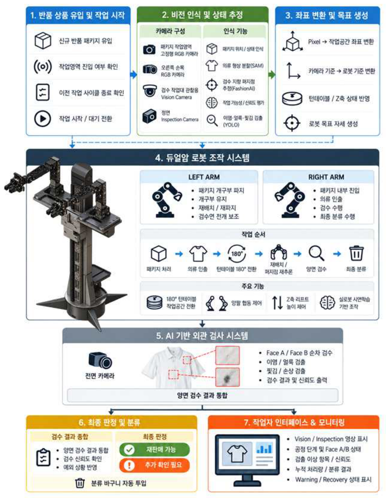
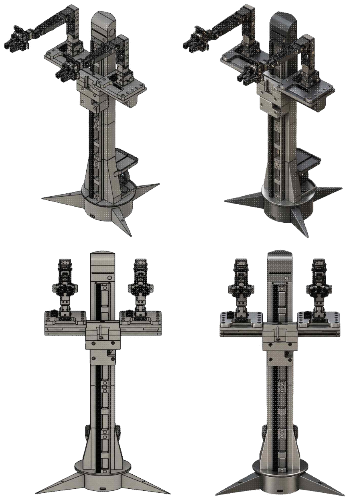
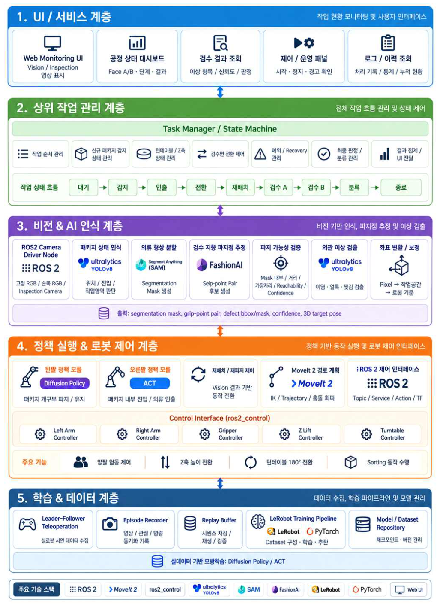
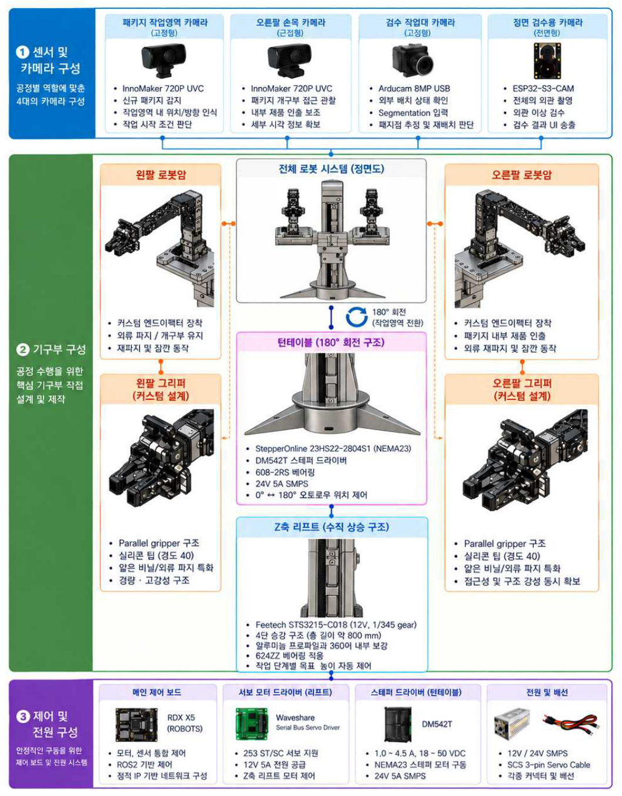
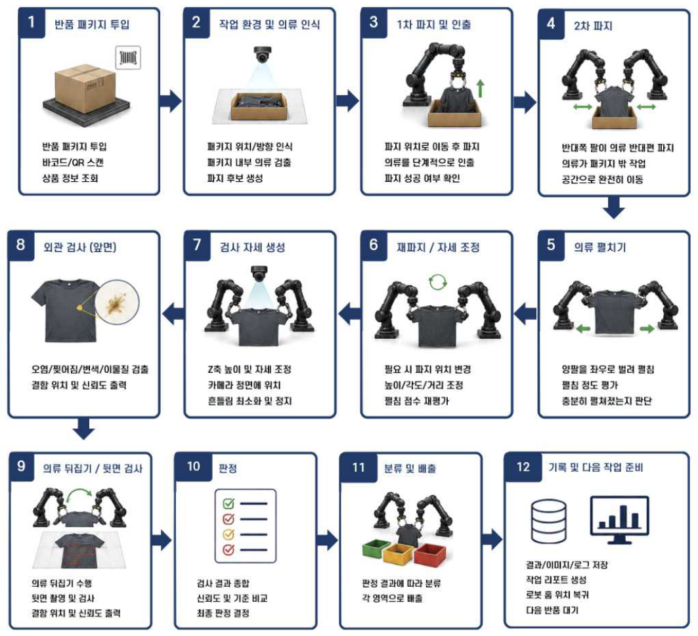
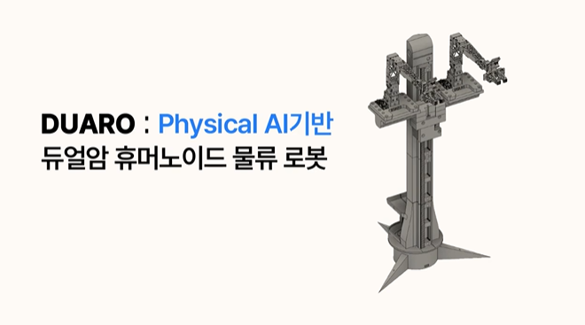

## **💡1. 프로젝트 개요**

**1-1. 프로젝트 소개**
- 프로젝트 명 : DUARO : Physical AI 기반 듀얼암 휴머노이드 물류 로봇
- 프로젝트 정의 : 반품 패키지 유입 감지부터 개봉, 제품 인출, 의류 재배치, 양면 외관 검수, 최종 분류까지를 하나의 듀얼암 시스템에서 연속 수행하는 Physical AI 기반 반품 물류 자동화 플랫폼

**1-2. 개발 배경 및 필요성**
- 2025년 국내 온라인쇼핑 거래액은 272조 원으로 전년 대비 4.9% 증가했고, 의복은 그중 8.2%인 약 22조 원을 차지합니다. 전자상거래 의류 피해구제 신청도 2021년 2,986건에서 2023년 4,571건으로 늘어, 반품 상품의 상태를 빠르게 확인하고 재판매 여부를 판단하는 역물류 공정의 중요성이 커지고 있습니다.
- 기존 물류 자동화는 접수, 인식, 이송, 분류, 기록처럼 정형화하기 쉬운 공정에 집중되어 있습니다. 반면 비닐 패키지를 열고 내부 제품을 꺼낸 뒤, 접히고 구겨진 의류를 검수 가능한 상태로 만드는 과정은 대상의 형상이 계속 변해 자동화가 어렵습니다. 결국 "검수 가능한 상태를 만드는 물리적 조작"이 반품 공정의 핵심 병목으로 남습니다.
- 반품 검수는 개봉, 정돈, 확인, 분류를 반복하기 때문에 작업자 피로와 숙련도에 따라 처리 속도와 판정 편차가 생기기 쉽습니다. 사람의 판단이 필요한 예외는 남기되 반복 작업을 안정적으로 자동화할 필요가 있습니다.

DUARO는 이러한 문제를 해결하기 위해 단순 반복 동작 로봇이 아니라,

"패키지를 열고 → 의류를 꺼내 → 현재 상태를 보고 다시 판단하며 → 양면을 검수하고 → 분류하는 로봇"
을 목표로 개발되었습니다.

**1-3. 프로젝트 특장점**
- 개봉부터 양면 검수와 분류까지 연결한 공정 통합
반품 패키지 개봉, 제품 인출, 양면 AI 검수, 최종 분류를 하나의 작업 셀로 연결했습니다. 단일 집기, 촬영, 분류 기능에 집중한 기존 로봇 프로젝트와 달리 반품 한 건을 끝까지 처리합니다.
- 공정 특성 기반 하이브리드 제어와 폐루프 판단
비정형 패키지 조작은 Teleoperation 시연을 학습한 정책이 담당합니다. 왼팔은 Diffusion Policy로 개구부를 확보하고 유지하며, 오른팔은 ACT로 내부에 진입해 제품을 인출합니다. 검수 단계에서는 FashionAI와 SAM 결과에 모델 신뢰도, 의류 영역, 파지 간격, 로봇 도달 범위를 함께 적용하고, 조건 미충족 시 재배치 후 재추론하는 폐루프로 공정을 연결합니다.
- 실제 반품 공정에 맞춘 하드웨어 Work Cell 설계
180° 턴테이블로 패키지 처리 영역과 검수 영역을 물리적으로 분리하고, 약 800 mm 4단 Z축 리프트로 패키지 처리, 작업대 조작, 검수, 분류 높이를 단계별로 전환합니다. 양팔 공통 Parallel Gripper(Slim Tip, 후방 보강, 경도 40 실리콘 접촉층)와 2단 작업대를 공정에 맞게 구성해 로봇을 이동시키지 않고 제한된 설치 면적에서 다단계 공정을 수행합니다.
- 센서 최소화와 현장 운영을 고려한 안전 측 설계
별도의 force sensor나 깊이 카메라 없이 고정형 RGB와 손목 RGB 중심으로 비전 조작 구조를 구성했습니다. 불확실한 검수 결과는 무리하게 정상으로 확정하지 않고 "추가 확인 필요"로 분류하며, 제어부와 분리된 Web UI에서 영상, 공정 상태, 판정 결과, 누적 처리 현황을 확인합니다.
- 공정별 4-Camera Perception
  Package Camera (InnoMaker 720P) : 신규 패키지 진입과 전체 작업영역 감시
  Wrist Camera (InnoMaker 720P, 오른팔) : 개구부 내부 접근과 제품 인출의 근접 관찰
  Vision Camera (Arducam 8MP) : 검수 작업대 위 의류 segmentation과 파지점 추론
  Inspection Camera (ESP32-S3-CAM) : 전개된 의류 한 면의 외관 검수

**1-4. 주요 기능**
- Teleoperation 기반 실로봇 시연 데이터 수집 : Leader-Follower 환경에서 작업자가 개구부 확보와 제품 인출을 직접 수행하고, Follower 관절 상태, 동작 명령, 그리퍼 상태, RGB 영상을 동일 시간축의 Episode로 저장
- 모방학습 기반 듀얼암 패키지 조작 : 왼팔 Diffusion Policy로 비닐 개구부 확보 및 유지, 오른팔 ACT로 개구부 내부 접근, 제품 파지, 인출
- 신규 패키지 감지 및 상태 기반 공정 제어 : 패키지 존재, 작업영역 진입, 이전 사이클 종료를 함께 확인해 작업을 시작하고, 완료 이벤트 기준으로 12단계 공정을 순차 제어
- 180° 작업공간 자동 전환 : 제품 인출 완료와 양팔 안전 자세를 확인한 뒤 NEMA23 스테퍼 기반 턴테이블로 Package Area와 Inspection Area 전환
- FashionAI-SAM 기반 검수 지향 파지점 추론 : FashionAI 후보점에 SAM mask 포함 여부, 경계 안전 여유, 파지점 간 거리, 로봇팔 도달 범위를 결합해 실제 사용 가능한 파지점 쌍 승인
- Vision-Reconfiguration 폐루프 의류 재배치 : 안정적인 파지점이 없으면 SAM mask의 최대 유효 단면을 기준으로 양팔이 의류를 소폭 들어 저속 재배치한 뒤 재추론
- 제품 보호형 안전 전개 및 양면 검수 : SAM mask 유효 폭 W 기준 전개 상한(d_target ≤ 0.95W), 저속 이동, 상대속도 제한을 적용하고 Controlled Lay-down과 재파지로 Face A, Face B 순차 검수
- YOLO 기반 외관 이상 검수 및 결과 통합 : Inspection Camera 영상에서 이염, 얼룩, 찢김을 검출하고 Face A/B 결과를 통합해 재판매 가능 또는 추가 확인 필요로 최종 판정
- 공정별 Z축 작업높이 전환 : 약 800 mm 4단 리프트를 Package, Manipulation, Inspection, Sorting Height로 전환
- 실시간 Web Monitoring 및 결과 관리 : 검수 영상, 현재 단계, Face A/B 상태, 검출 class와 confidence, 재배치 여부, 최종 판정, 누적 처리량을 제어부와 분리된 Monitoring Layer에서 표시

**1-5. 기대 효과 및 활용 분야**
- 기대 효과 : 반품 검수의 반복 수작업을 줄이고 일관된 검사와 판정 이력을 확보해 처리 효율 향상. 패키지 처리부터 양면 검수와 분류까지 하나의 설비에 통합해 제한된 물류 공간에 적용 가능한 자동화 모델 제시. OMX-AI 로봇팔, ROS 2, LeRobot 등 오픈소스와 3D 프린팅 기반 직접 제작 구조로 고가 전용 설비 대비 가격 우위 확보
- 활용 분야 : 패션 이커머스와 반품 물류센터의 반품 의류 검수 자동화, 의류 리셀, 렌탈, 세탁 서비스의 상태 기록과 등급 판정, 비정형 물체 조작 로봇 연구와 교육, 섬유 제품, 봉제 부품, 포장재 등 유연 물체의 경량 물류 검수 및 분류

**1-6. 기술 스택**
- OS / 로봇 미들웨어 : Ubuntu 24.04 LTS, ROS 2 Jazzy, MoveIt 2, ros2_control, TF2, RViz2, rmw_zenoh_cpp
- 모방학습 : LeRobot (팀 fork), Diffusion Policy, ACT, Cyclo Intelligence Teleoperation, Accelerate DDP, Docker
- 비전 : PyTorch, OpenCV, FashionAI (CPN 키포인트), SAM, YOLO, ONNX Runtime, Homography 기반 Pixel-to-World 변환, ChArUco Hand-eye Calibration
- 보조축 제어 : RDK X5, Feetech STS3215-C018 (Waveshare Serial Bus Servo Driver), NEMA23 + DM542T, ESP-IDF (ESP32-S3-CAM)
- UI : Streamlit 기반 Web Monitoring Dashboard
- 하드웨어 설계 및 제작 : Fusion 360, FlashPrint, Flashforge Adventurer 5M Pro, Bambu Lab PLA, 알루미늄 프로파일 보강, 경도 40 액상 실리콘
- 협업 : GitHub, Notion, Discord

---

## **💡2. 팀원 소개(이름 기재X)**

|  |  |  |  |  |  |
|:---:|:---:|:---:|:---:|:---:|:---:|
| **멘티1** | **멘티2** | **멘티3** | **멘티4** | **멘티5** | **멘토** |
| • 프로젝트 총괄 <br> • 그리퍼, Z축 3D 설계 <br> • RDK X5 보조축 제어 | • Teleoperation 데이터 수집 <br> • ACT 학습, 추론 파이프라인 <br> • 카메라 Calibration | • ROS 2, MoveIt2 환경 구축 <br> • 로봇팔 파지 동작 제어 | • FashionAI-SAM 비전 파이프라인 <br> • Web Monitoring UI | • YOLO 외관 검수 <br> • 문서, 보고서 작성 | • 프로젝트 멘토 <br> • 기술 자문 |

---
## **💡3. 시스템 구성도**

- 시스템 구성도



- 전체 로봇 설계



- SW 구성도



- HW 구성도



- 서비스 흐름도



---
## **💡4. 작품 소개영상**

[](https://www.youtube.com/watch?v=wKP68ynVCIY)

---
## **💡5. 핵심 소스코드**

- 소스코드 설명 : 공정 상태 제어. AI 출력이 곧바로 액추에이터 명령이 되지 않도록 상태 검증과 Interlock을 거친 뒤 턴테이블 회전, Z축 전환, 파지, 검수, 분류를 순서대로 호출합니다. (`process_controller/controller.py`, `process_controller/interlock.py`)

```Python
# 보조축 동작은 항상 Interlock 검사 → 실행 → 결과 확인 순서로만 호출한다
def _move_height(self, target: Height, phase_done: bool = True) -> None:
    self.interlock.check_height_change(phase_done=phase_done, arms=self.policy.pose())
    if not self.aux.move_height(target):
        raise ProcessFault(f"Z축 {target.value} 이동 실패")
    time.sleep(self.cfg.settle_s)

def _rotate_turntable(self) -> None:
    self._require(self.motion.go_safe_pose(), "Safe Pose 이동 실패")
    self._move_height(Height.SAFE)
    # Extraction Complete + 양팔 Safe Pose + Z Safe Height 가 모두 만족돼야 회전
    self.interlock.check_turntable(self._extraction_complete, self.policy.pose(), self.aux.current_height())
    if not self.aux.rotate_turntable_180():
        raise ProcessFault("턴테이블 회전 실패")

def _workspace_switching(self) -> None:
    self._rotate_turntable()
    self._move_height(Height.MANIPULATION)
    self._require(self.motion.place_on_table(), "작업대 내려놓기 실패")
    self._go(State.GARMENT_RECONFIGURATION, "turntable 180 done, garment on table")

def _garment_reconfiguration(self) -> None:
    pair = self.vision.estimate_grip_pair()               # FashionAI-SAM Grip Pair + reason
    if pair.valid and self.motion.grasp_pair(pair):
        self._move_height(Height.INSPECTION)
        # SAM 유효 폭 W 기준 전개 상한 d_target <= 0.95 W
        self._require(self.motion.present_to_camera(max_spread_m=self.cfg.spread_ratio * pair.garment_width_m), "의류 전개 실패")
        self._go(State.FACE_A_INSPECTION, "inspection-ready grip pair")
        return
    if self.cycle.reconfiguration_count >= self.cfg.max_reconfiguration:
        self._go(State.RESULT_INTEGRATION, "reconfiguration limit")   # → 추가 확인 필요
        return
    plan = self.vision.plan_reconfiguration()              # SAM mask 최대 유효 단면 기준 재배치
    self._require(self.motion.reconfigure(plan), "재배치 동작 실패")
    self.cycle.reconfiguration_count += 1
    self._go(State.GARMENT_RECONFIGURATION, f"reconfigured ({plan.reason})")
```

- 소스코드 설명 : FashionAI-SAM 검수 지향 파지점 결정. FashionAI 키포인트의 점수와 SAM mask 포함 여부를 확인한 뒤, 통과한 점을 mask 안쪽으로 보정하고 두 점의 각도와 거리를 검사해 파지점 쌍을 승인합니다. (`grasp/vision/deep_fashion/fashionai-key-points-detection/garment_inspection_roi_mvp.py`)

```Python
def semantic_grasp_pair(phase, clothing_type, keypoints, scores, mask, rois, crop_shape, args):
    group = "shoulder" if phase == PHASE_SHOULDER else "hem"
    names = KEYPOINT_NAMES[clothing_type]
    wanted = TARGETS[clothing_type][group]
    tolerance = max(5, int(round(max(crop_shape) * 0.03)))
    raw_targets = []
    for name in wanted:
        index = names.index(name)
        raw_u, raw_v, visible = keypoints[index].tolist()
        point = (int(round(raw_u)), int(round(raw_v)))
        score = float(scores[index])
        raw_targets.append({
            "name": name, "raw_u": point[0], "raw_v": point[1], "score": round(score, 6),
            "visible": bool(visible > 0),
            "near_garment_mask": point_near_mask(mask, point, tolerance),
            "threshold_passed": bool(visible > 0 and score >= args.keypoint_threshold),
        })

    # 팔 배정은 의미론적 좌/우가 아니라 카메라 x 좌표 기준
    raw_targets.sort(key=lambda item: item["raw_u"])
    distance = cv2.distanceTransform((mask > 0).astype(np.uint8), cv2.DIST_L2, 5)
    radius = max(8, int(round(np.hypot(mask.shape[1], mask.shape[0]) * args.grasp_search_radius)))
    refined = []
    for arm, target in zip(("left", "right"), raw_targets):
        item = dict(target)
        item["arm"] = arm
        grasp = None
        if item["threshold_passed"] and item["near_garment_mask"]:
            grasp = refine_semantic_point((item["raw_u"], item["raw_v"]), mask, distance, rois[arm], radius)
        item["grasp_u"], item["grasp_v"] = (grasp if grasp is not None else (None, None))
        item["grasp_found"] = grasp is not None
        refined.append(item)

    geometry = pair_geometry(
        [(item["grasp_u"], item["grasp_v"]) for item in refined if item["grasp_found"]],
        mask.shape[1], args.max_pair_angle, args.min_pair_distance, args.max_pair_distance,
    )
    return refined, geometry
```

- 소스코드 설명 : YOLO 양면 외관 검수와 결과 통합. 한 면씩 검출 결과를 만들고, 시야 미확보, 결함 검출, 불확실 검출은 모두 "추가 확인 필요"로 보내는 보수적 판정을 적용합니다. (`inspection/inspector.py`, `inspection/integrator.py`)

```Python
def inspect(self, frame, side, garment_mask=None):
    area_ratio = float((garment_mask > 0).mean()) if garment_mask is not None else self._garment_area_ratio(frame)
    valid = area_ratio >= self.min_garment_area_ratio          # 검수 시야 확보 여부
    # 불확실 구간 하한(record_conf)까지 기록하고, 결함 확정 여부는 integrator 가 판단
    result = self.model.predict(frame, conf=self.record_conf, imgsz=self.imgsz, verbose=False)[0]
    defects = [
        Defect(cls=self.names[int(box.cls[0])], confidence=float(box.conf[0]),
               bbox=[float(v) for v in box.xyxy[0].tolist()])
        for box in result.boxes
    ]
    return InspectionResult(side=side, passed=len(defects) == 0, valid=valid, defects=defects)

def integrate(self) -> IntegratedResult:
    a, b = self.results["A"], self.results["B"]
    invalid = [r.side for r in (a, b) if not r.valid]
    if invalid:
        return IntegratedResult(FinalDecision.ADDITIONAL_INSPECTION, f"Face {', '.join(invalid)} 검수 시야 미확보", a, b)
    confirmed = [(r.side, d) for r in (a, b) for d in r.defects if d.confidence >= self.defect_conf_threshold]
    if confirmed:
        return IntegratedResult(FinalDecision.ADDITIONAL_INSPECTION, "이상 검출", a, b)
    lo, hi = self.uncertain_band
    if any(lo <= d.confidence < hi for r in (a, b) for d in r.defects):
        return IntegratedResult(FinalDecision.ADDITIONAL_INSPECTION, "판정 불확실", a, b)
    return IntegratedResult(FinalDecision.RESELLABLE, "양면 이상 없음", a, b)
```

- 소스코드 설명 : Z축 리프트 폐루프 높이 제어. STS3215 서보를 속도 모드로 두고 누적 tick을 mm로 환산해 P 제어로 목표 높이를 추종하며, 과전류 시 즉시 차단합니다. (`rdk/z_axis_lift/lift_axis.py`)

```Python
def step_towards(self, target_mm: float) -> tuple[float, float, bool]:
    """P 제어 한 스텝. (현재 mm, 쓴 속도, 도달 여부) 반환."""
    cur = self.get_height_mm()
    err = target_mm - cur
    if abs(err) <= self.cfg.on_target_mm:
        self._write_vel_user(0)
        return cur, 0.0, True
    v = max(-self.cfg.v_max, min(self.cfg.v_max, self.cfg.kp_vel * err))
    v = self._guard(v, cur)
    self._write_vel_user(v)
    return cur, v, v == 0.0

def goto_mm(self, target_mm, timeout_s=30.0, period_s=0.03, on_step=None, settle_s=0.5):
    """목표 높이까지 블로킹 이동. 도달 후 settle_s 동안 오버슈트를 보정하고 정지."""
    target_mm = max(self.cfg.soft_min_mm, self.cfg.descent_floor_mm, min(self.cfg.soft_max_mm, target_mm))
    t_end = time.monotonic() + timeout_s
    t_done = None
    try:
        while time.monotonic() < t_end:
            if self.check_overcurrent():
                raise RuntimeError("overcurrent cutoff during goto")
            cur, v, done = self.step_towards(target_mm)
            if done and t_done is None:
                t_done = time.monotonic()
            if t_done is not None and time.monotonic() - t_done >= settle_s:
                break
            time.sleep(period_s)
    finally:
        self.stop()
        self.save_state()
    return self.get_height_mm()
```

---

## 소스 폴더 구조

DUARO의 실행 소스코드를 공정 단계별로 정리한 디렉터리입니다. 각 폴더의 README에 원본 저장소와 실행 방법이 있습니다.

```
26_HC265/
├── setup/                  # 각종 셋팅
│   ├── hardware/           #   양팔 Parallel Gripper, Z축 리프트 STL/STEP
│   ├── camera/esp32-cam/   #   Inspection Camera 펌웨어, UDP 수신 서버
│   ├── teleoperation/      #   Cyclo + Zenoh Leader-Follower 데이터 수집 운영
│   ├── calibration/        #   uv_to_world(ROS2 hand-eye), 호모그래피, 모터 캘리
│   ├── robot_description/  #   OMX-F URDF/xacro, omx_l MoveIt config
│   └── docs/               #   LeRobot 설치, 텔레옵, MoveIt, 카메라, 트러블슈팅
├── act/                    # 모방학습 (Diffusion Policy / ACT)
│   ├── dualarm_inference/  #   양팔 팔별 수집 + 순차 추론 (최신)
│   ├── gpu_server_pipeline/#   데이터 변환, DDP 학습, GPU PolicyServer, 안전 프로파일
│   ├── lerobot_wrappers/   #   record / train / replay 래퍼
│   └── lerobot_fork/       #   팀 fork LeRobot 변경분 (omx_follower, omx_leader, 패치)
├── rdk/                    # RDK X5 보조축: Z축 리프트 + 턴테이블 조그, 기록, 재현
├── grasp/                  # 로봇팔 파지
│   ├── vision/             #   SAM + FashionAI 파지점 / 재배치 후보
│   ├── motion/             #   좌표 → 접근 → 수직 하강 → 파지 → 들기 (직접 IK)
│   └── moveit_scripts/     #   MoveIt2 봉지 진입, pick and place
├── inspection/             # YOLO 양면 외관 검수 + Face A/B 결과 통합
├── ui/                     # Streamlit 실시간 검수 대시보드 (Monitoring Layer)
├── process_controller/     # 12단계 공정 상태머신 + S/W Interlock
└── docs/images/            # 구성도
```
